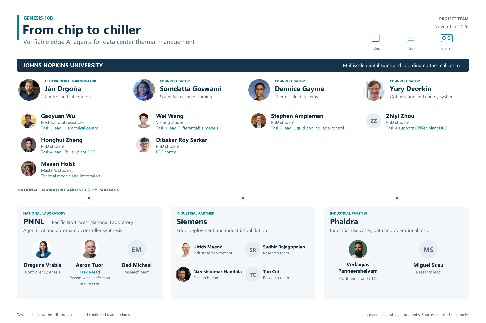

  

<h3 align="center">Verifiable edge AI for data center thermal management</h3>

**CHIP2CHILLER** is a Genesis 10B research collaboration developing energy-efficient, reliable thermal control from chips and racks to facility cooling. We combine differentiable digital twins, hierarchical predictive control, and AI agents that automate controller synthesis and verification.

Our work connects:

- **Models:** multiscale thermal dynamics and differentiable simulation.
- **Control:** liquid-cooling loops, chiller plants, and coordinated operation across scales.
- **Verification:** reproducible benchmarks and validation of controllers for industrial edge deployment.

## Team

Led by **Johns Hopkins University**, in collaboration with **Pacific Northwest National Laboratory**, **Siemens**, and **Phaidra**.

| Task | Focus | Lead |
| --- | --- | --- |
| 1 | Differentiable models | Wei Wang |
| 2 | Liquid-cooling loop control | Stephen Ampleman |
| 4 | Chiller-plant differentiable predictive control | Honghui Zheng; support: Zhiyi Zhou |
| 5 | Hierarchical control | Gaoyuan Wu |
| 6 | System-wide verification and release | Aaron Tuor |

Task numbers follow the project work plan. Siemens roster updated November 4, 2026. Task assignments confirmed October 2026. [Image credits](https://github.com/Genesis-CHIP2CHILL/.github/blob/main/profile/IMAGE_CREDITS.md).

## Explore

Browse the [organization’s repositories](https://github.com/orgs/Genesis-CHIP2CHILL/repositories) for project code and research resources.
